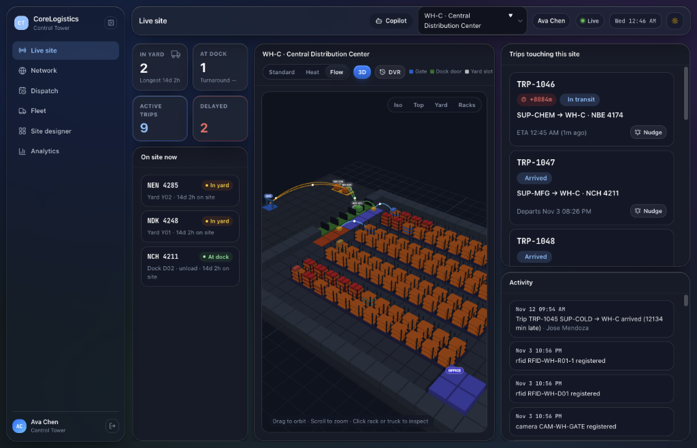
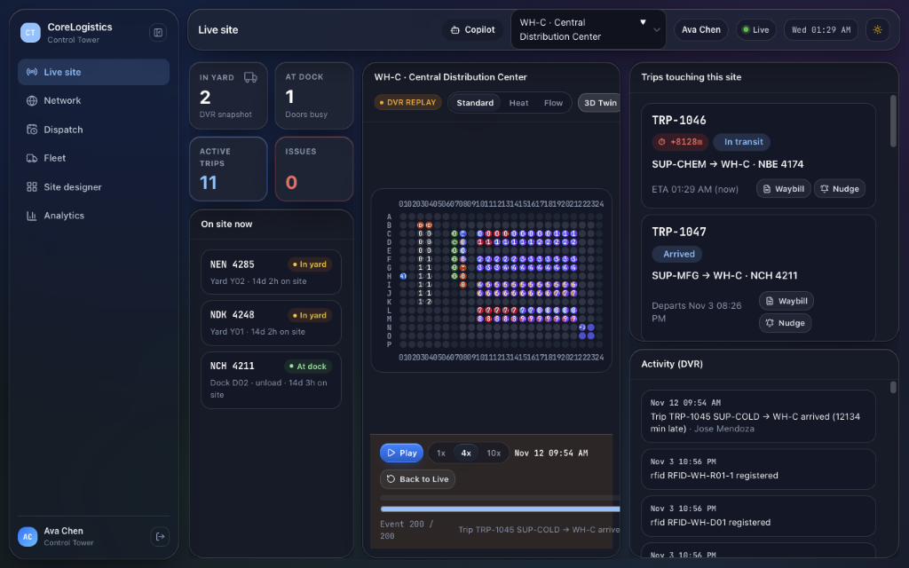
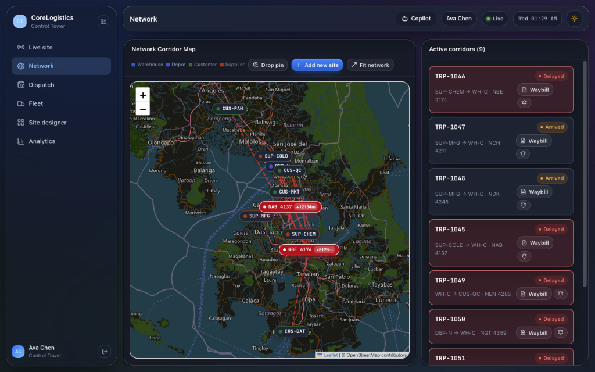
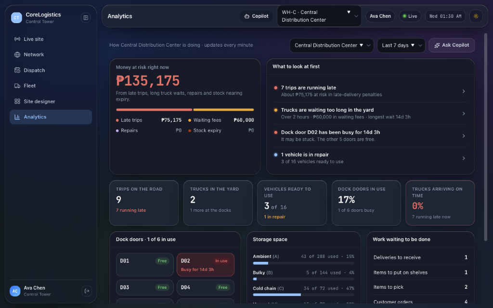
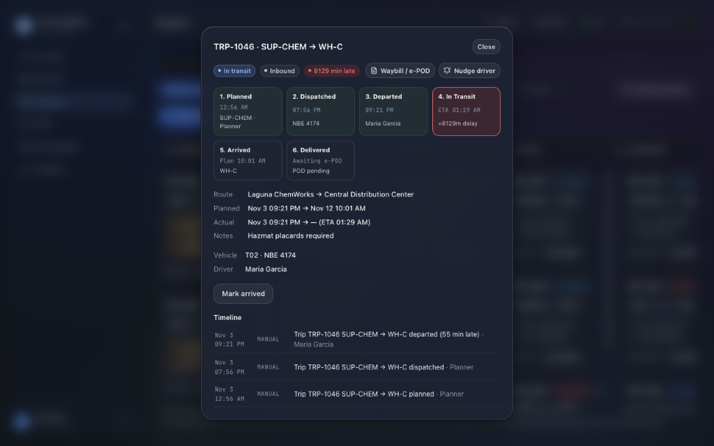
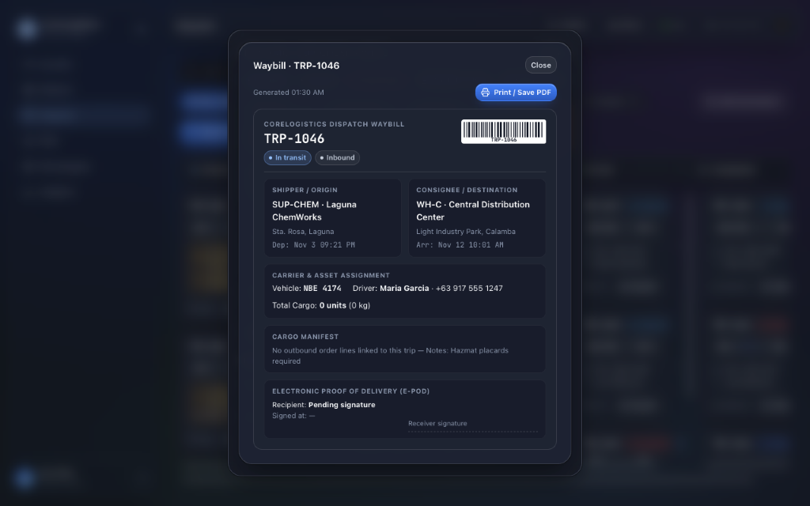
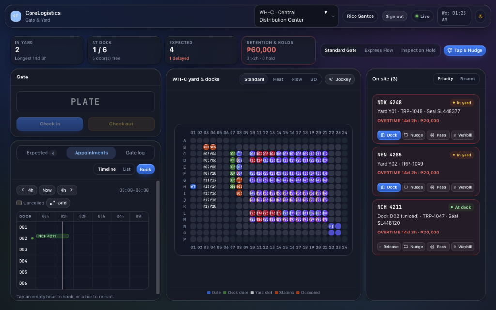

# CoreLogistics Build Summary — Night Session (Nov 17–18, 2026)

This document summarizes all features, UI/UX enhancements, API endpoints, database migrations, screenshots, and verification results implemented on branch `gemini-implementation-1`.

---

## 1. Control Tower: Live Site, 3D Digital Twin & Operations DVR Replay

- **Multi-Lens Interactive Floorplan (`Standard` / `Heat` / `Flow` / `3D`)**
  - **`SiteMap`** (`packages/ui/src/SiteMap.tsx`): Added `lens` (`"standard" | "heat" | "flow"`) visualization modes with dwell-heat coloring, occupancy percentages, and automated SVG flow arcs connecting gates, yard slots, dock doors, staging/sort lanes, and storage racks.
  - **`SiteMap3D`** (`packages/ui/src/SiteMap3D.tsx`): Three.js interactive 3D warehouse & yard twin (`OrbitControls`, raycast click selection, hover tooltips, `Iso` / `Top` / `Yard` / `Racks` camera presets, volumetric multi-level rack shelving with pallet totes, semi-trucks at docks/yard stalls, dock aprons, gates, and live heatmap/flow orb animations).
  - **`RackInspector`** (`packages/ui/src/RackInspector.tsx`): Stacked level-by-level bay cross-section showing HU utilization and occupancy per rack level inside `LiveView`.
- **Operations DVR Replay**
  - **Engine** (`packages/ui/src/dvr.ts`, unit tests in `packages/ui/src/dvr.test.ts`): `buildDvrBuckets()` and `replaySiteState()` reconstruct facility occupancy, active trips, issues, and highlights from chronological event history (`GET /events`).
  - **Controls** (`apps/control-tower/src/LiveView.tsx`): Live DVR scrub bar, Play/Pause, `1x` / `4x` / `10x` playback speed, issue/nudge markers, and **Back to Live** reset.

---

## 2. Network Corridor Map, Blank-Slate Site Creation & Route Destinations

- **Real OpenStreetMap + Leaflet Geographic Network Map**
  - **`NetworkMapView`** (`apps/control-tower/src/NetworkMapView.tsx`): Interactive OpenStreetMap canvas plotting warehouses, depots, customers, and suppliers with live active corridor routes, moving truck progress indicators, delayed SLA alerts, `Active corridors` right rail, and 1-click **`Waybill`** & **`Nudge`** buttons.
- **Control Tower Site & Destination Provisioning**
  - **`NewSiteModal`** (`apps/control-tower/src/NewSiteModal.tsx`): Allows Control Tower planners to create new `customer` / `supplier` destinations or blank-slate `warehouse` / `depot` facilities (`POST /sites`).
  - Integrated via **`Drop pin`**, **`Add destination`**, and **`Add new site`** controls in `NetworkMapView.tsx` and `DesignerView.tsx`, with handoff of newly created depots/warehouses straight into the **Site Designer**.

---

## 3. Better Analytics Tab: Financial Exposure, Priority Triage & FEFO Watch

- **Backend Risk & FEFO Engine** (`apps/api/src/modules/analytics/service.ts`, `packages/contracts/src/analytics.ts`)
  - Extended `GET /analytics/summary` (`summary()`) with `risk` telemetry in `PHP`:
    - `delayPenaltyExposure` (late active trips),
    - `yardDetentionExposure` (open gate visits dwelling `> 120` minutes),
    - `maintenanceCost` (open/period maintenance spend),
    - `expiringSoonCount`, `expiredCount`, `expiringUnitsQty`, `atRiskInventoryValue`, and `fefoWatchlist`.
- **Analytics UI & Triage Redesign** (`apps/control-tower/src/AnalyticsView.tsx`, `apps/control-tower/src/designer-live.css`)
  - Displays plain-language **Money at risk right now** breakdown bar (`Late trips`, `Waiting fees`, `Repairs`, `Stock expiry`), clickable **What to look at first** priority triage list, 5 operational KPI tiles (`TRIPS ON THE ROAD`, `TRUCKS IN THE YARD`, `VEHICLES READY TO USE`, `DOCK DOORS IN USE`, `TRUCKS ARRIVING ON TIME`), **`Dock doors`**, full-width **`Storage space`** progress bars, **`Work waiting to be done`**, **`Activity · last 7 days`** charts, and **`FEFO & expiry watch`**.
  - Added a clickable **`EXPOSURE & FEFO`** summary card on Control Tower `Live site` jumping directly to Analytics.

---

## 4. End-to-End Dispatch Visibility, Printable Waybill & Tap-and-Nudge

- **Chain-of-Custody Journey Ribbon & Printable Waybill**
  - **`JourneyRibbon`** (`packages/ui/src/JourneyRibbon.tsx`): 6-stage timeline (`Planned` -> `Dispatched` -> `Departed` -> `In Transit` -> `Arrived` -> `Delivered`) embedded in Dispatch trip inspection.
  - **`WaybillModal`** (`packages/ui/src/WaybillModal.tsx`, `GET /trips/:id/waybill` in `apps/api/src/modules/trips/routes.ts`): Structured barcode waybill sheet with shipper/consignee details, cargo manifest, FEFO lot table, e-POD signature & photo proofs, and clean `@media print` sheet formatting.
- **Live Tap & Nudge Messaging + Proof Photos**
  - **API** (`apps/api/src/modules/ops/routes.ts`, `packages/contracts/src/events.ts`): `GET /ops/nudges`, `POST /ops/nudges` (Control Tower & Gate), and `POST /ops/nudges/:id/ack` with Web Audio chime and base64 image proof validation.
  - **UI** (`packages/ui/src/NudgeTray.tsx`): `NudgeBanner`, `SendNudgeModal`, and client-side JPEG-compressing `PhotoProofPicker` wired across Control Tower, Driver (`apps/driver/src/App.tsx`), Warehouse (`apps/warehouse/src/App.tsx`, `apps/warehouse/src/ShipView.tsx`), and Gate.
- **Smooth Motion & Instant Tab Navigation** (`apps/control-tower/src/App.tsx`, `packages/ui/src/motion.tsx`)
  - Background preloading of lazy Control Tower views and stabilized GSAP card transitions to eliminate tab and KPI flicker.

---

## 5. Gate & Yard Portal Command Upgrade (`apps/gate`)

- **Command KPI Strip & Operating Posture** (`apps/gate/src/App.tsx`, `apps/gate/src/index.css`): Top KPI cards (`IN YARD`, `AT DOCK`, `EXPECTED`, `DETENTION & HOLDS` in `₱`), `Standard Gate` / `Express Flow` / `Inspection Hold` modes, and 1-tap **`Tap & Nudge`**.
- **Dock Door Shift Gantt Timeline & Rescheduling** (`apps/gate/src/GateTimeline.tsx`): Inline 6h Shift Gantt + expandable 12h **Dock Door Schedule Matrix** (`Grid` modal), click-to-book empty door/hour slots, live docked bars, and inline door/`-30m`/`+30m` re-slotting (`PATCH /gate/appointments/:id`).
- **Security Inspection, Condition Proof Photos & Printable Gate Pass** (`apps/api/migrations/009_gate_control.sql`, `apps/gate/src/GatePassModal.tsx`, `packages/contracts/src/gate.ts`): `Cleared` / `Hold` toggle (`PATCH /gate/visits/:id/inspection`), check-in/out `PhotoProofPicker`, optional Direct-to-Dock routing on check-in, barcode **Gate Pass / Yard Slip** printing, and Trip `WaybillModal` access.
- **Priority Queue & Visual Jockey Map Dispatch**: `On site` `Priority` / `Recent` sorting with `OVERTIME` detention badges, single-row quick actions (`Dock`/`Release`, `Nudge`, `Pass`, `Waybill`), `Standard | Heat | Flow | 3D` yard lenses, and `Jockey` click-to-move dispatch onto free docks or yard slots.

---

## 6. Verification & Migrations

- **Database Migration Added**: `apps/api/migrations/009_gate_control.sql` (adds `proof_photo_in`, `proof_photo_out`, and `inspection_status` to `gate_visits`).
- **Full Verification Run (`npm test && npm run typecheck && npm run build`)**:
  - `npm test`: **87 / 87** API tests across 18 suites (`apps/api/src/flow.test.ts`, `apps/api/src/release-validation.test.ts`, and copilot/stock/access suites); **16 / 16** `@corelogistics/ui` unit tests across 4 suites (`packages/ui/src/dvr.test.ts`, `copilotSurface.test.ts`, `scanSession.test.ts`, `utils.test.ts`).
  - `npm run typecheck`: Exited `0` across `@corelogistics/api`, `@corelogistics/control-tower`, `@corelogistics/driver`, `@corelogistics/gate`, `@corelogistics/warehouse`, `@corelogistics/contracts`, `@corelogistics/ui`, and `tests/tsconfig.json`.
  - `npm run build`: Exited `0` across all frontend and workspace builds.
